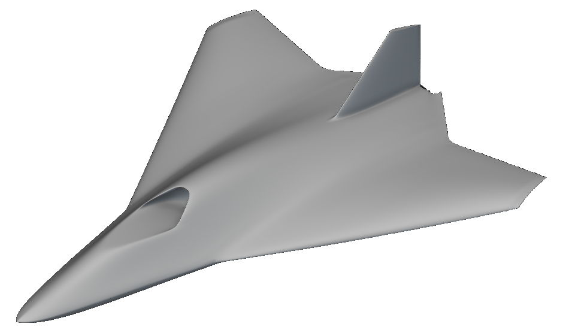

# nTop to CPACS

A measured GBI Rev38 round trip through the nTop Notebook API:
export the aircraft to CPACS 3.5.1, change tip twist from 2 to 4 degrees,
update the native notebook, and export the rebuilt geometry.



The example includes a repaired wing/body twist transition. The 4-degree case
retains the original center-body shape and distributes the additional twist
through a smooth transition. The report uses nTop document styling with blue accents.

## Inspect the verified example

| Artifact | Contents |
|---|---|
| [Report](examples/gbi/demo.html) | Native views, measured contours, repair explanation, and checks |
| [Changed notebook](examples/gbi/GBI-changed.ntop) | Repaired native model at 4 degrees |
| [Baseline notebook](examples/gbi/GBI-baseline.ntop) | Native model at 2 degrees |
| [Baseline CPACS](examples/gbi/baseline.xml) | Measured geometry before the edit |
| [CPACS request](examples/gbi/request.xml) | The supported control set to 4 degrees |
| [Changed CPACS](examples/gbi/changed.xml) | Fresh geometry after the native rebuild |
| [Verification](examples/gbi/verification.json) | API, schema, source, recipe, and geometry evidence |

GitHub shows HTML source. Clone the repository and serve the report locally:

```powershell
git clone https://github.com/bradrothenberg/ntop-to-cpacs.git
cd "ntop-to-cpacs"
uv sync --locked
uv run python scripts/verify_example.py
uv run python scripts/serve_report.py examples/gbi
```

Open the local URL printed by the server. The offline verifier needs Python and
uv. It does not need nTop. It checks file hashes, CPACS coordinates, saved graph
values, the twist law, and rejection of unsupported edits.

## Run a fresh native round trip

Use Windows, a licensed nTop Automate installation, and an nTop build that exposes
the prototype Python Console Notebook API. Set the path to that build explicitly:

```powershell
uv sync --locked
.\run_demo.ps1 -NTopExe "C:\path\to\Notebook API build\ntop.exe"
```

The runner uses `C:\Program Files\nTopology\nTopology\ntopcl.exe` for native
measurements. Set `NTOPCL_EXE` if nTop Automate is installed elsewhere.
`NTOP_NOTEBOOK_EXE` can supply the Notebook API executable instead of `-NTopExe`.

Each run creates a dedicated nTop process and a new directory under `runs`.
It installs the smooth twist transition through the Notebook API, then captures
the 2-degree baseline. The CPACS request changes only `Tip twist` to 4 degrees.
The runner saves the model, measures fresh sections, verifies the files, and
reopens the final notebook. Earlier runs and other nTop sessions remain intact.

The initial console shortcut can briefly change focus. All later API commands
use a background console bridge. If Windows blocks the shortcut, open the Python
Console in the task's `GBI-demo.ntop` window with Ctrl+backtick, then resume:

```powershell
.\run_demo.ps1 -Name "your-run-name" -Resume
```

Resume checks the process identity and completed command markers. It refuses to
resubmit an API command whose outcome is unknown. Inspect a failed or timed-out
measurement before retrying. Each native batch has a 120-second limit.

Fresh runs generate the HTML report and contour plots. The bundled native images
were captured with the nTop native renderer. The runner does not create those images.

## The repaired transition

The previous 4-degree update added 11.614 mm of vertical placement across the
source's 0.086044 m root-protection band. This produced the visible crease just
outside the center body.

The repair preserves the source's 2-degree geometry. Additional twist uses
`g(t) = t^4 (35 - 84t + 70t^2 - 20t^3)`, with `t` clamped to `[0, 1]`.
The transition starts at construction `|Y| = 0.3055 m` and ends at `1 m`.
These positions come from the existing GBI construction. The gate and its first
three derivatives match the constant branches at both endpoints.

The twist law is:

```text
u = min(abs(Y) / 2.7432 m, 1)
t = clamp((abs(Y) - 0.3055 m) / 0.6945 m, 0, 1)
twist = 2 deg * u + (Tip twist - 2 deg) * u * g(t)
```

The final tip remains at 4 degrees. Native coordinate maps compose with this law,
so construction coordinates do not define exact world-space transition boundaries.

Validation includes 11,001 scalar samples and 288 native field points per model.
Protected-band native fields agree with the original baseline within numerical
precision. Tested outer stations at `Y = 1.5 m` and `2 m` match the previous
4-degree model. All 31 remeasured baseline contour arrays are byte-identical to
the original 2-degree arrays. The repaired candidate and final 4-degree recipes
are identical. Saved native views were inspected.

See the [repair evidence](examples/gbi/native-transition-verification.json) and
[twist-law audit](examples/gbi/twist-law-audit.json). Field differences are not
surface-distance measurements. These checks address the reported root crease;
they do not establish global surface fairness or aerodynamic performance.

## Parameter contract

The only writable CPACS value is:

```text
/cpacs/toolspecific/tool/ntop:bridge/ntop:tipTwistDeg
```

Namespace: `urn:ntop:gbi:cpacs:1`. This maps to native `Tip twist` with explicit
`deg` units. This demonstration supports 2 and 4 degrees. It rejects other values,
nonfinite values, and all other XML edits before changing nTop.

```powershell
uv run python scripts/cpacs_bridge.py edit examples/gbi/baseline.xml request.xml --tip 4
uv run python scripts/cpacs_bridge.py check examples/gbi/baseline.xml request.xml
```

`geometryTipTwistDeg` identifies the measured geometry snapshot. When it differs
from `tipTwistDeg`, the XML is an update request. Its measured geometry changes
only after nTop rebuilds and the exporter measures the result.

## Geometry and verification

CPACS contains 20 blended wing/body sections and 11 fin sections. Standard CPACS
nodes store normalized airfoil coordinates, chord scaling, and metre translations.
The wing/body uses mirror symmetry. A 90-degree rotation places the fin.
The verifier independently composes these transforms and compares the reconstructed
points with native samples.

The original Rev38 source remains in `source/GBI-V38.ntop`, with SHA256:

```text
44acc807b70ef83ad130c73cbe5957843fe9ff194b3391dc7fa8f805cfaae7a5
```

Native notebooks retain inlet and exhaust passages and the fin-root blend.
The CPACS section representation omits those details and approximates geometry
between sections. The 0.002 m slice setting is a sampling setting, not a measured
surface-error tolerance. TiGL loft compatibility remains unverified.

`baseline-working.ntop` and `changed-working.ntop` are the direct API saves.
The presentation copies change only saved UI state, with named, collapsed sections.
The completed example contains API readback and final-notebook reopen receipts.
Public receipts use relative filenames. Local process records and logs are excluded.

## Code map

| File | Role |
|---|---|
| `run_demo.ps1` | Dedicated native session and guarded workflow |
| `scripts/repair_twist.py` | Notebook API construction of the smooth transition |
| `scripts/api_runtime.py` | Native parameter update, save, and readback |
| `scripts/native_sampling.py` | Native section measurements in batches of four |
| `scripts/cpacs_bridge.py` | CPACS export, schema validation, and strict edit contract |
| `scripts/verify_demo.py` | Independent transform and saved-graph verification |
| `scripts/verify_example.py` | Portable checks on the bundled example |
| `scripts/audit_twist_transition.py` | Scalar twist and placement comparison |
| `scripts/verify_native_transition.py` | Native field comparisons |
| `scripts/make_demo_report.py` | nTop report from measured results |

Sampling instruments separate saved copies using the verified Rev38 container
codec. It removes passages and fin unions only in the envelope measurement copy.
Native design edits use the live Notebook API.

CPACS sources: [official website](https://dlr-sl.github.io/cpacs-website/) and
[3.5.1 schema](https://www.cpacs.de/schema/v3_5_1/cpacs_schema.xsd).
The schema is unchanged. A wrapper imports the typed nTop tool extension.
See [third-party notices](THIRD_PARTY_NOTICES.md).
